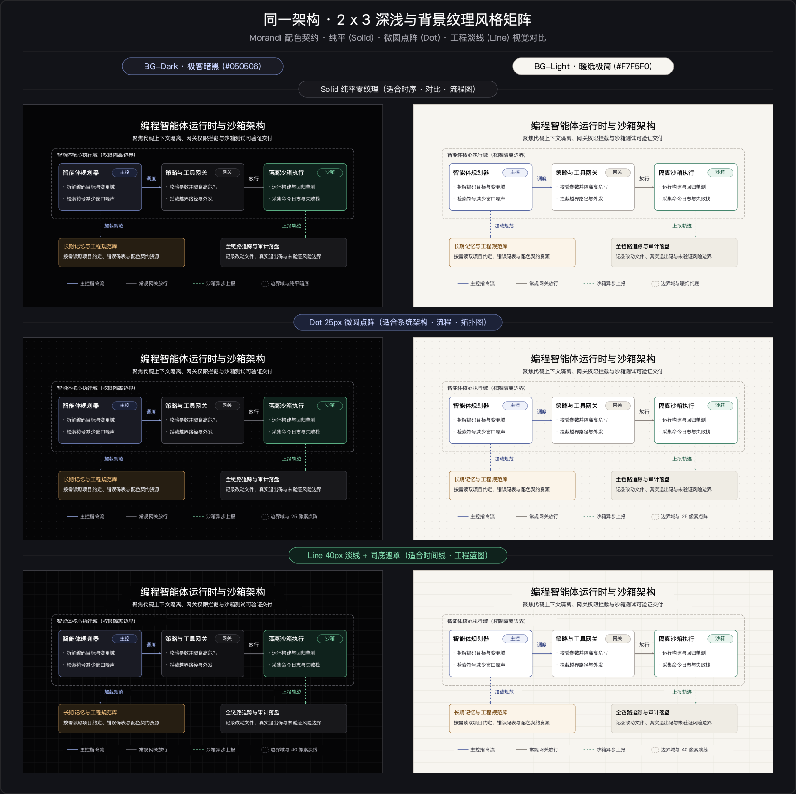
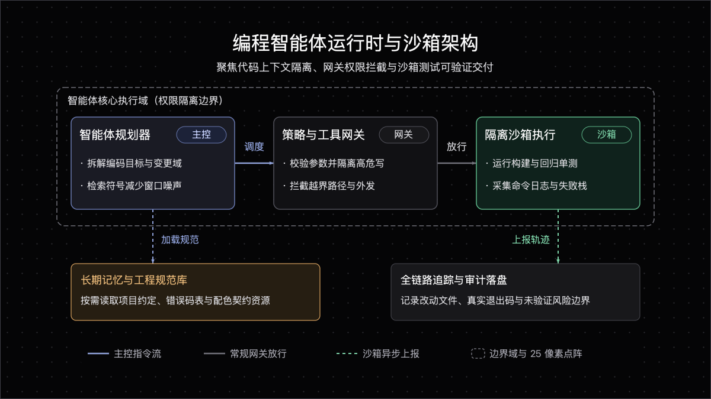
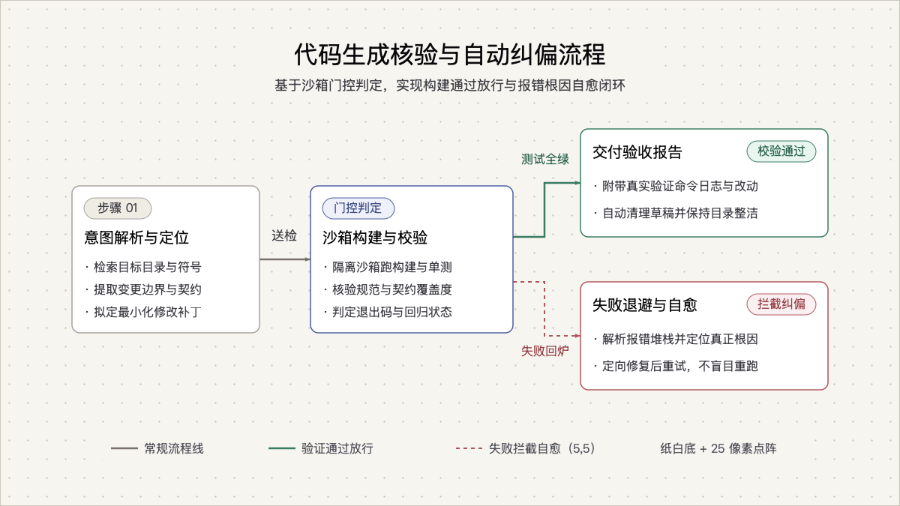
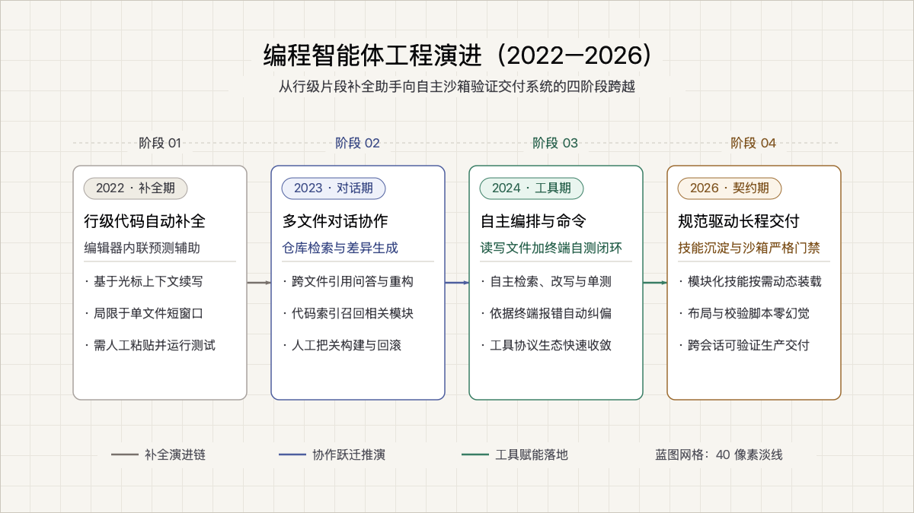
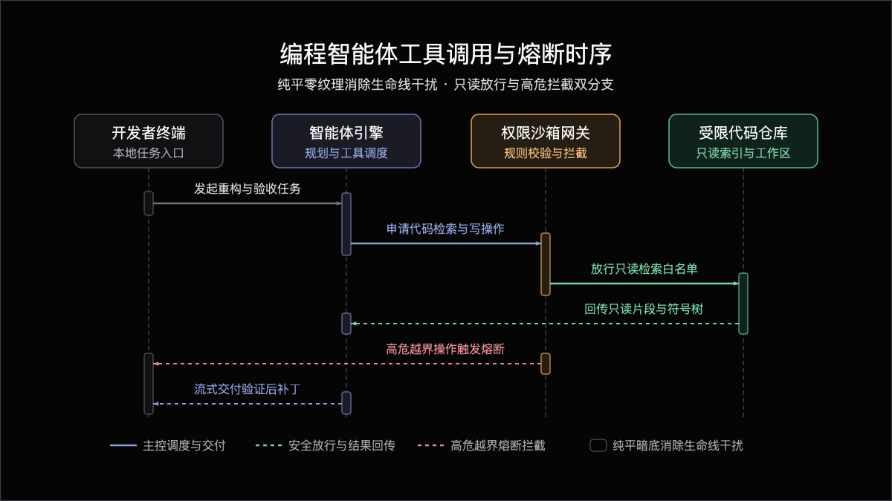
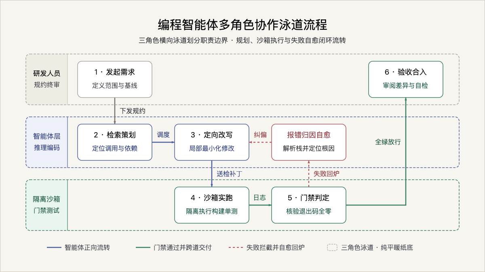
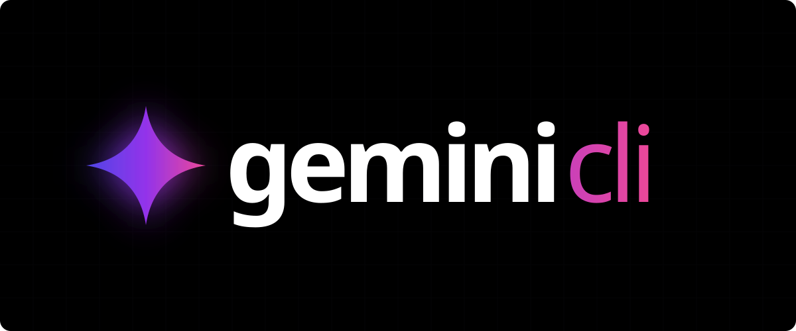
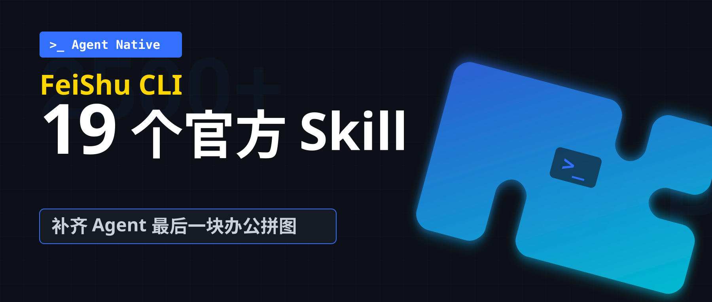

<div align="center">

# guage-svg-gen

**Generate publication-grade, pure-code SVG technical diagrams that pass strict geometry, color, and typography gates on the first try.**

[](https://github.com/guage1029/guage-svg-gen/releases)
[](#quick-start-in-30-seconds)
[](#why-guage-svg-gen)
[](https://github.com/guage1029/guage-svg-gen)

**[简体中文](README.md)** · **[English](README.en.md)**

</div>

---

Raw LLM-generated SVGs almost always break in production: text overflows cards, arrows slice through labels, CJK/Latin fallback turns into tofu boxes, background grids collide with thin strokes, and default neon palettes clash on dark or light themes.

**guage-svg-gen** is an **Agent Skill** designed for **Claude Code, OpenAI Codex CLI, Antigravity, and Gemini CLI**. Instead of hoping an LLM guesses pixel coordinates in one shot, it pairs an explicit `layout.json` spatial contract with **4 deterministic validation gates** (SVG structure, language hygiene, token-only color contracts, and bounding-box geometry) plus real raster preview inspection before delivery.

<p align="center">
  
</p>

> The exact same semantic architecture (*Coding Agent Runtime & Sandbox*) rendered across **Geek Dark (`BG-Dark` `#050506`)** and **Warm Paper (`BG-Light` `#F7F5F0`)** × **Solid (`solid`) / 25px Dot Grid (`dot`) / 40px Faint Line + Label Halos (`line`)**. All 6 variants pass `run_pipeline.py --strict`.

---

## Showcase Gallery

All engineering diagrams below share one cohesive topic (**Coding Agent Engineering**), demonstrating `guage-svg-gen` across major diagram families and cover layouts:

### 1. System Architecture (`BG-Dark` · `dot` 25px grid)

Layered system topology with dashed isolation boundaries, **Color-by-Source** directional routing, and external legend Alignment.

<p align="center">
  
</p>

- SVG Source: [docs/showcase/showcase-architecture-dark.svg](docs/showcase/showcase-architecture-dark.svg) · Light Variant: [showcase-architecture-light.svg](docs/showcase/showcase-architecture-light.svg)

---

### 2. Engineering Flowchart (`BG-Light` · `dot` 25px grid)

Balanced 3-column orthogonal workflow showing sandbox gate checks splitting cleanly into **Verified Pass** and **Error Self-Healing**.

<p align="center">
  
</p>

- SVG Source: [docs/showcase/showcase-flowchart.svg](docs/showcase/showcase-flowchart.svg)

---

### 3. Evolution Timeline (`BG-Light` · `line` 40px blueprint grid + Label Halos)

Four-stage engineering progression (`2022–2026`) where pre-edge **Label Halos** cleanly mask out `40px` background grid lines behind headings, stage badges, and legends.

<p align="center">
  
</p>

- SVG Source: [docs/showcase/showcase-timeline.svg](docs/showcase/showcase-timeline.svg)

---

### 4. Interaction Sequence Diagram (`BG-Dark` · `solid` flat canvas)

Automatically routes to a **zero-texture `solid` background** so vertical dashed lifelines remain crisp and distraction-free, featuring segmented activation bars around crossing return arrows and dual read-pass / circuit-breaker semantics.

<p align="center">
  
</p>

- SVG Source: [docs/showcase/showcase-sequence.svg](docs/showcase/showcase-sequence.svg)

---

### 5. Multi-Role Swimlane Flowchart (`BG-Light` · `solid` flat warm paper canvas)

Cross-lane orchestration across **Developer**, **Coding Agent**, and **Isolated Sandbox** lanes with flush header tabs, open `30px` routing channels, orthogonal transitions, and a red self-heal feedback loop.

<p align="center">
  
</p>

- SVG Source: [docs/showcase/showcase-swimlane.svg](docs/showcase/showcase-swimlane.svg)

---

### 6. Editorial Hero Covers (Creative Glow & Bold Typography)

Beyond structural diagrams, `guage-svg-gen` crafts bold vector hero covers with gradients and visual focal weight:

<p align="center">
  
  
</p>

- SVG Source: [gemini_cli_v0.38_cover_v2.svg](docs/showcase/gemini_cli_v0.38_cover_v2.svg) · [Wechat_Cover_Feishu_Skill_19.svg](docs/showcase/Wechat_Cover_Feishu_Skill_19.svg)

<details>
<summary><b>Browse all 6 SVG source files from the 2×3 Style Matrix</b></summary>

| Theme \ Texture | `solid` (Flat) | `dot` (25px Dot Grid) | `line` (40px Grid + Label Halos) |
| --- | --- | --- | --- |
| **`BG-Dark` (`#050506`)** | [showcase-architecture-dark-solid.svg](docs/showcase/showcase-architecture-dark-solid.svg) | [showcase-architecture-dark.svg](docs/showcase/showcase-architecture-dark.svg) | [showcase-architecture-dark-line.svg](docs/showcase/showcase-architecture-dark-line.svg) |
| **`BG-Light` (`#F7F5F0`)** | [showcase-architecture-light-solid.svg](docs/showcase/showcase-architecture-light-solid.svg) | [showcase-architecture-light.svg](docs/showcase/showcase-architecture-light.svg) | [showcase-architecture-light-line.svg](docs/showcase/showcase-architecture-light-line.svg) |

</details>

---

## Why `guage-svg-gen`?

### 1. Deterministic Theme × Background Routing Matrix

The skill automatically selects the background texture matched to your diagram topology:

| Diagram Family | Default Texture | Engineering Rationale |
| --- | --- | --- |
| **Architecture / Topology / Workflow** | `dot` (25px subtle dots) | Anchors spatial alignment subtly without cluttering interiors |
| **Timeline / Roadmap / Spec Blueprint** | `line` (40px faint lines + halos) | Reinforces grid alignment while masking intersections behind labels |
| **Sequence / Comparison / Swimlane / Cover** | `solid` (flat background) | Removes visual noise competing with lifelines, lanes, or large headlines |

### 2. Scheme 3 Morandi Palette & `Color-by-Source`

- Replaces harsh `#000000` blacks and saturated neon defaults with curated [**Scheme 3 Morandi tokens**](skills/guage-svg-gen/assets/color-tokens.json) (`BG-Dark #050506` and `BG-Light #F7F5F0`).
- Edges inherit color semantics from their source node or state (indigo primary flow, sage green return/async, dusty rose circuit-breaker), maintaining **`>= 4.5:1` WCAG contrast**.

### 3. Four Hard Validation Gates (`run_pipeline.py --strict`)

Every generated SVG must pass 4 automated checks against its `layout.json` plan before delivery:

| Validator | Focus | Catches Automatically |
| --- | --- | --- |
| [`validate_svg.py`](skills/guage-svg-gen/scripts/validate_svg.py) | Structure, contrast & font stacks | Transparent/unbounded backgrounds, unsafe URLs, undersized fonts (`>=16px` / `>=18px` covers) |
| [`validate_language.py`](skills/guage-svg-gen/scripts/validate_language.py) | Copy consistency & CJK/Latin policy | Accidental internal terms, raw units, or unallowlisted English noise in ZH diagrams |
| [`validate_color.py`](skills/guage-svg-gen/scripts/validate_color.py) | Token allowlist & role mapping | Hardcoded unapproved hex colors or cross-theme token leakage |
| [`validate_geometry.py`](skills/guage-svg-gen/scripts/validate_geometry.py) | Measured bounding boxes & edges | Node collisions (`E_NODE_OVERLAP`), text clipping (`E_TEXT_OVERFLOW`), occluded labels (`E_EDGE_OCCLUDED`) |

### 4. Real Raster Preview & 1:1 Crop Verification

[`render_preview.py`](skills/guage-svg-gen/scripts/render_preview.py) renders verified previews via **Playwright Chromium** or **CairoSVG**, extracts center `1:1` cover thumbnail crops, checks for blank/transparent edges, and removes temporary artifacts cleanly.

---

## Quick Start in 30 Seconds

### Install the Skill

Compatible with any tool supporting the open [Agent Skills](https://agentskills.io) standard (**Claude Code**, **OpenAI Codex CLI**, **Antigravity**, and **Gemini CLI**):

```bash
git clone https://github.com/guage1029/guage-svg-gen.git
cd guage-svg-gen

# Install to Claude Code (~/.claude/skills) or Codex / Antigravity (~/.agents/skills)
bash scripts/install.sh --dest ~/.claude/skills --yes

# Non-interactive install with custom output workspace:
bash scripts/install.sh --dest ~/.agents/skills --workspace ~/Documents/svg-output --yes --skip-deps
```

Optional preview rendering dependencies:

```bash
pip install -r skills/guage-svg-gen/requirements.txt
```

Gemini CLI extension manifest is maintained in [integrations/gemini/gemini-extension.json](integrations/gemini/gemini-extension.json) (`0.17.28`). See [skills/guage-svg-gen/README.md](skills/guage-svg-gen/README.md) for the standalone out-of-the-box setup guide (`Python >= 3.10`, `Pillow >= 10.0.0`, `cairosvg >= 2.7.1`, `fontconfig`, and optional `playwright >= 1.40.0` / `svgo`).

### Example Prompts

Once installed, trigger the skill naturally in chat:

- **Architecture**: `Draw a dark dot-grid architecture diagram showing our LLM Gateway, Policy Router, and Sandbox Runner.`
- **Timeline**: `Create a warm paper light 40px line-grid evolution timeline for 2022–2026 with clean label halos.`
- **Swimlane**: `Design a three-lane swimlane flowchart across User, Coding Agent, and Sandbox Gate including a failure self-heal loop, and verify with strict mode.`
- **In-place edit**: `Switch this SVG's background style from dot to solid, re-run all four strict gates, and render a preview.`

---

## Pipeline CLI & Verification Suite

For local orchestration or CI pipelines:

```bash
# Run all 4 strict gates atomically and remove draft on success
python3 skills/guage-svg-gen/scripts/run_pipeline.py \
  --svg /tmp/draft.svg \
  --plan docs/architecture.layout.json \
  --output-svg docs/architecture.svg \
  --cleanup-draft \
  --strict \
  --json

# Run skill unit tests (14 tests)
python3 skills/guage-svg-gen/scripts/test_skill_scripts.py

# Run full release verification (version sync, JSON check, leak check & 18 smoke tests)
bash scripts/check_release.sh
```

<details>
<summary><b>Repository Layout</b></summary>

```text
guage-svg-gen/
├── README.md                                  # Chinese documentation & showcase
├── README.en.md                               # English documentation & showcase
├── docs/showcase/                             # Rendered PNG previews & validated SVG sources
├── integrations/gemini/gemini-extension.json  # Gemini CLI extension manifest (v0.17.28)
├── scripts/
│   ├── install.sh                             # Interactive / scripted installer
│   ├── package_skill.sh                       # Clean distributable skill packager
│   └── check_release.sh                       # Release gate (versions / JSON / path leak / smoke tests)
├── tests/                                     # 18 regression smoke test fixtures
└── skills/guage-svg-gen/                      # Core Agent Skill (v0.17.28 · author: donglin)
    ├── SKILL.md                               # Style routing matrix, contracts & workflow
    ├── README.md                              # Standalone out-of-the-box setup & environment guide
    ├── requirements.txt                       # Preview & geometry dependency constraints
    ├── assets/                                # Color tokens, font whitelist, schemas & templates
    ├── references/                            # BG-Dark / BG-Light guides & error-code manual
    ├── evals/                                 # Benchmark eval suite & reference assets
    └── scripts/                               # 4 validators, auto-fixer, preview & pipeline CLI
```

</details>

---

If `guage-svg-gen` helps you generate cleaner technical diagrams in less time, please consider leaving a **Star** or sharing ideas in [Issues](https://github.com/guage1029/guage-svg-gen/issues).
