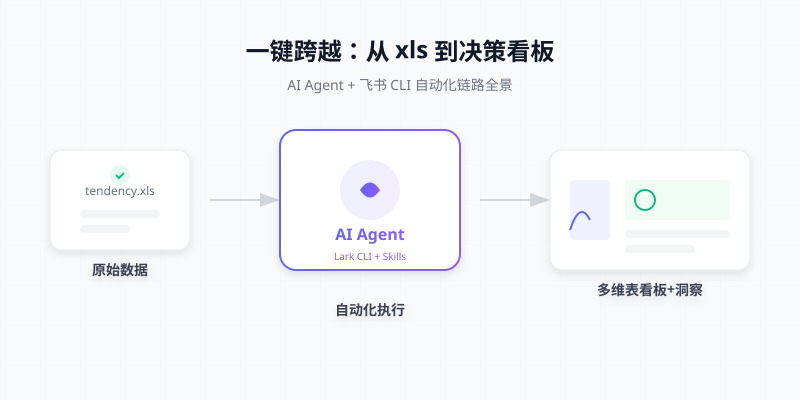
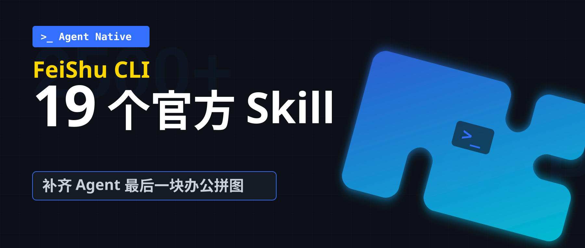
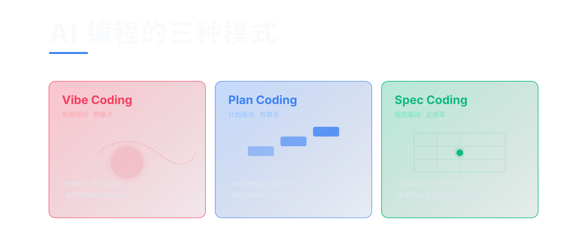

# SVG Architect (v0.15)

**公众号专属工业级 SVG 设计引擎**

`svg-architect` 是一个遵循 [Agent Skills](https://agentskills.io) 协议的专业级设计 Skill，专为公众号内容创作者打造。通过 AI Agent 驱动，一句话生成封面图、配图、架构图、流程图等高质量 SVG 图像，完美适配手机端阅读体验。

---

## 设计成品展示

### 架构全景图 / 自动化流程图



### 公众号封面图
<p align="center">
  
  
</p>

### 逻辑模型 / 概念图
<p align="center">
  
  
</p>

---

## 核心特性

- **公众号原生适配**：封面图 1800×766px、配图 1200×500px，自动处理安全区，手机端不裁切
- **六种专业风格**：Tech Dark / Minimal Clean / Glass Premium / Neubrutalism / Bento Info / Clay Soft
- **工业级验证**：内置 Python 脚本自动校验 viewBox、对比度、ID 前缀、字体栈、字号下限、安全标签等
- **QA 预览渲染**：Playwright/Chromium 驱动，自动输出 preview.png + 焦点裁切缩略图 + 渲染质量报告
- **评测闭环**：64 条 eval 用例（触发/负例/风格覆盖/输出质量），配套 eval_protocol.md 指导评测执行
- **原位进化**：修改已有图时直接覆盖原文件，不产生冗余副本
- **纯代码生成**：无需设计软件，SVG 跨平台渲染一致

---

## 快速安装

```bash
# 克隆仓库
git clone https://github.com/zhaodl1983/svg-architect.git
cd svg-architect

# 运行安装向导（初始化 workspace + 安装到 Claude Code）
bash scripts/install.sh
```

安装向导会完成：
1. 初始化 SVG 产出物目录（workspace）
2. 安装 Python 后处理依赖（可选，仅 PNG 导出需要）
3. 将 skill 安装到你选择的 AI 工具目录

---

## 项目结构

```
svg-architect/
├── scripts/
│   └── install.sh                  # 安装向导（运行此脚本开始）
├── skills/
│   └── svg-architect/              # Agent Skills 标准 skill 根
│       ├── SKILL.md                # 核心指令
│       ├── references/             # 按需加载的参考文档
│       │   ├── platform_profiles.md
│       │   ├── layout_plan.schema.json
│       │   ├── quality_checklist.md
│       │   ├── error_codes.md
│       │   ├── prompt_template.md
│       │   └── specs/              # 六种风格规格说明
│       │       ├── tech_dark.md
│       │       ├── minimal_clean.md
│       │       ├── glass_premium.md
│       │       ├── neubrutalism.md
│       │       ├── bento_info.md
│       │       └── clay_soft.md
│       ├── assets/                 # 静态资源
│       │   ├── fonts_whitelist.json
│       │   └── templates/
│       ├── scripts/                # 验证与后处理脚本
│       │   ├── svg_validator.py    # 规范校验（ID前缀/字体/对比度/尺寸）
│       │   ├── render_svg_preview.py  # QA 预览渲染（Playwright/cairosvg）
│       │   ├── svg_fixer.py
│       │   ├── optimize_and_convert.py
│       │   ├── run_pipeline.py
│       │   └── tests/
│       │       ├── run_smoke_tests.sh  # 17 条冒烟测试
│       │       └── cases/             # 12 个 SVG 测试用例
│       └── requirements.txt
├── evals/                          # 评测体系
│   ├── eval_protocol.md            # 评测执行协议
│   ├── trigger_evals.json          # 正例触发用例（24 条）
│   ├── negative_evals.json         # 负例用例（16 条）
│   ├── style_coverage_evals.json   # 风格覆盖用例（12 条）
│   └── output_quality_evals.json   # 输出质量断言（12 条）
└── docs/
    └── showcase/                   # 设计成品展示
```

---

## 使用方法

在支持 Agent Skills 的工具（Claude Code、Cursor 等）中直接输入需求：

```
帮我做一张公众号封面图，主题是"AI 编程的三种模式"
画一张微服务架构的配图，科技暗黑风格
出一张 RAG 检索流程的示意图
```

---

## 脚本工具（手动使用）

```bash
# 验证 SVG 合规性（自动检测平台）
python skills/svg-architect/scripts/svg_validator.py --svg input.svg

# 严格模式（WARN 也视为失败，报告 JSON）
python skills/svg-architect/scripts/svg_validator.py --svg input.svg --strict --json

# 指定平台与 ID 前缀
python skills/svg-architect/scripts/svg_validator.py \
  --svg input.svg --platform wechat_cover --id-prefix svga-

# QA 预览渲染（输出 preview.png / thumbnail_crop.png / visual_report.json）
python skills/svg-architect/scripts/render_svg_preview.py \
  --svg input.svg --platform wechat_article --out-dir ./preview/

# 自动修复常见错误
python skills/svg-architect/scripts/svg_fixer.py --svg input.svg

# 导出 PNG
python skills/svg-architect/scripts/optimize_and_convert.py input.svg --format png

# 完整流水线（验证 + 修复 + 输出）
python skills/svg-architect/scripts/run_pipeline.py --svg input.svg --slug my-cover

# 运行冒烟测试（17 条）
bash skills/svg-architect/scripts/tests/run_smoke_tests.sh
```

---

## 环境要求

- Python 3.8+（必须，用于验证脚本）
- playwright + chromium（推荐，QA 预览渲染主引擎）：`pip install playwright && playwright install chromium`
- Pillow + numpy（图像分析，随 playwright 一并安装）：`pip install Pillow numpy`
- cairosvg（可选，渲染备用引擎）：需本机安装 libcairo
- svgo（可选，SVG 压缩优化）

---

**作者**：zhaodl1983 | **许可证**：MIT | **协议**：[Agent Skills](https://agentskills.io)
