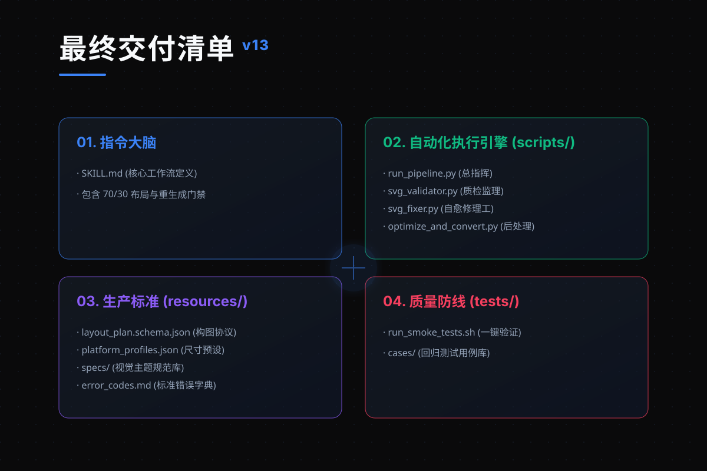

# Guage SVG Gen (v0.17.23)

**公众号专属工业级 SVG 设计引擎**

`guage-svg-gen` 是一个遵循 [Agent Skills](https://agentskills.io) 协议的专业级 SVG 技术图表与配图 Skill。通过 AI Agent 驱动，输出结构清晰、字体字号可控、几何与对比度严格校验的纯代码 SVG（结构架构图、流程图、原理图、时序图、层级图、ER 图、状态机与双核对比图卡）。

---

## 设计成品展示

### 架构全景图 / 自动化流程图


### 公众号封面图
<p align="center">
  
  
</p>

### 逻辑模型 / 概念图
<p align="center">
  
  
</p>

---

## 核心特性

- **16:9 默认画幅 + 定宽弹性高度分档**：
  - `wechat_article`（默认）：锁定 `1200px` 宽度确保跨图字号与网格标尺一致，默认 **`16:9`（`1200×675`）**，支持 `2.4:1`（`1200×500`）/ `16:9`（`1200×675`）/ `4:3`（`1200×900`）/ `1:1`（`1200×1200`）或 `[500, 1200]` 间 `25` 的整数倍高度；正文配图自动附带像素级 `1px` 整数裁切收边外框。
  - `wechat_cover`（显式封面需求）：保持 `1800×766px`（无外框，满足微信 `2.35:1` 封面规格）。
- **黑白极简双核心风格**：收敛为 **`bg_dark`（默认：`#050506` 黑底 + `25px` 灰网格 + 中性深炭灰卡片）**与 **`bg_light`（`#F7F5F0` 纸白底 + `25px` 暖灰网格 + 纯白实体卡片）**，配套透明填充虚线区（`fill="none"` 消除框内外色差）、四级圆角规范与蓝紫语义高亮。
- **全流程质量门禁（`run_pipeline.py --strict`）**：内置结构/对比度/字号检查（`validate_svg.py`）、中文优先文案校验（`validate_language.py`）、主题色与语义角色校验（`validate_color.py`）、节点/端口/正交连线/文本框越界校验（`validate_geometry.py`）及确定性自愈（`fix_svg.py`）。
- **隔离视觉 QA（`render_preview.py`）**：渲染 `preview.png` + 水平中央 50% `thumbnail_crop.png` + `visual_report.json` 到临时目录，检查透明背景与 `cairosvg` 隐患并自动 `--cleanup-dir`。
- **标准化起手模板与评测闭环**：提供黑白双套 `16:9` 起手模板（`assets/svg-starter-template.svg` / `svg-starter-light-template.svg` + 配对 `.layout.json`）与 `skills/guage-svg-gen/evals/` 测试基准。

---

## 快速安装

```bash
# 克隆仓库
git clone https://github.com/guage1029/guage-svg-gen.git
cd guage-svg-gen

# 安装（交互模式）
bash scripts/install.sh

# 或非交互安装（CI / 自动化环境）
bash scripts/install.sh --dest ~/.claude/skills --workspace ~/svg-output --yes --skip-deps
```

安装向导会完成：
1. 初始化 SVG 产出物目录（workspace，默认 `$HOME/Documents/workspace/svg-architect`）
2. 安装 Python 依赖（可选，PNG 导出与 QA 预览渲染需要）
3. 将 skill 安装到目标 AI 工具 Skills 目录

---

## 项目结构

```
guage-svg-gen/
├── README.md
├── .gitignore
├── scripts/
│   ├── install.sh                       # 安装向导（--dest / --workspace / --yes / --skip-deps）
│   └── check_release.sh                 # 发布前自检脚本
├── skills/
│   └── guage-svg-gen/                   # Agent Skills 标准 skill 根目录
│       ├── SKILL.md                     # 核心指令与工作流契约
│       ├── requirements.txt             # 可选后处理与 QA 预览依赖
│       ├── assets/                      # 按需加载的设计资产与默认 16:9 起手模板
│       │   ├── color-tokens.json
│       │   ├── fonts-whitelist.json
│       │   ├── language-policy.json
│       │   ├── layout-plan.schema.json
│       │   ├── layout-plan-template.json
│       │   ├── layout-plan-light-template.json
│       │   ├── svg-starter-template.svg
│       │   └── svg-starter-light-template.svg
│       ├── references/                  # 风格规格与错误码手册（单层扁平结构）
│       │   ├── style-bg-dark.md
│       │   ├── style-bg-light.md
│       │   └── error-codes.md
│       ├── scripts/                     # PEP 723 验证、流水线与渲染预览脚本
│       │   ├── validate_svg.py
│       │   ├── validate_color.py
│       │   ├── validate_geometry.py
│       │   ├── validate_language.py
│       │   ├── fix_svg.py
│       │   ├── optimize_svg.py
│       │   ├── render_preview.py
│       │   ├── run_pipeline.py
│       │   └── test_skill_scripts.py
│       └── evals/                       # 评测集与评测夹具
│           ├── evals.json
│           ├── trigger-queries.json
│           └── files/
├── tests/                               # 仓库级冒烟测试（不随 skill 安装）
│   ├── run_smoke_tests.sh
│   └── cases/
├── integrations/
│   └── gemini/
│       └── gemini-extension.json        # Gemini CLI 扩展清单
└── docs/
    └── showcase/                        # 设计成品展示
```

---

## 脚本工具与自检

```bash
# 运行完整流水线（草稿严格校验 + 输出正式 SVG + 自动清理草稿）
python3 skills/guage-svg-gen/scripts/run_pipeline.py \
  --svg /tmp/draft.svg \
  --plan out/my-diagram.layout.json \
  --output-svg out/my-diagram.svg \
  --cleanup-draft --strict --json

# 隔离视觉 QA 预览渲染（完成后使用 --cleanup-dir 清理临时目录）
python3 skills/guage-svg-gen/scripts/render_preview.py \
  --svg out/my-diagram.svg --platform wechat_article --strict --json

# 运行单元回归测试（10 项）
python3 -B skills/guage-svg-gen/scripts/test_skill_scripts.py

# 运行仓库级冒烟 + 单元测试（18/18 PASS）
bash tests/run_smoke_tests.sh

# 发布前全量自检
bash scripts/check_release.sh
```

---

## 环境要求

- Python 3.10+（必须，用于验证、几何/语言门禁与流水线脚本）
- `Pillow>=10.0.0`、`cairosvg>=2.7.1`（或 `playwright` + Chromium）用于 `render_preview.py` 与 PNG 导出
- `fontconfig`（`fc-match`）用于本地字体检查；`svgo`（可选）用于 SVG 压缩

---

**作者**：donglinzhao (`guage1029`) | **许可证**：MIT | **协议**：[Agent Skills](https://agentskills.io)
