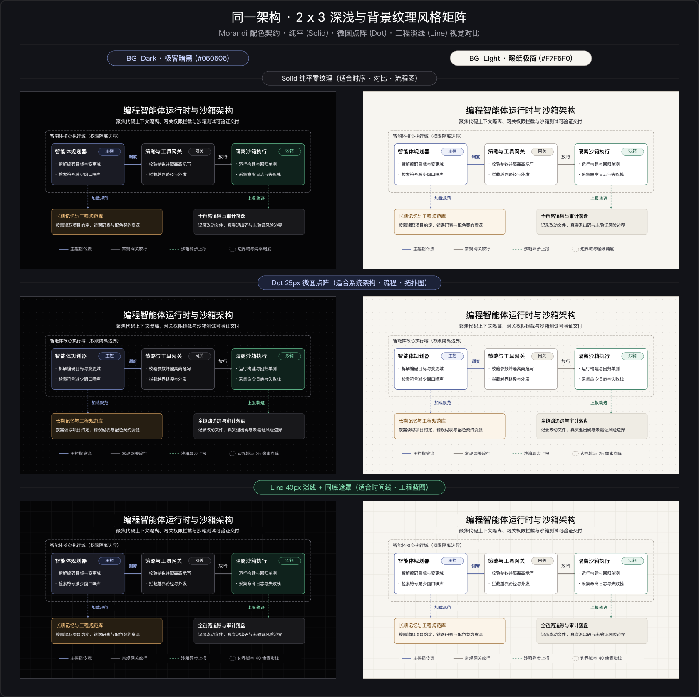
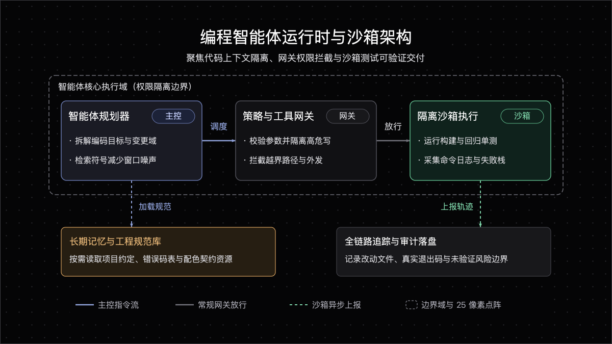
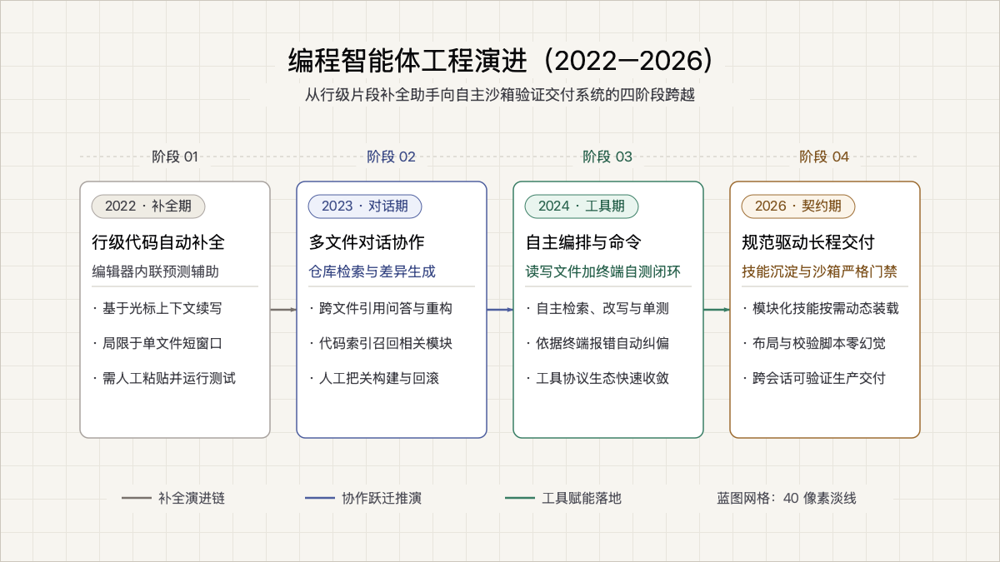
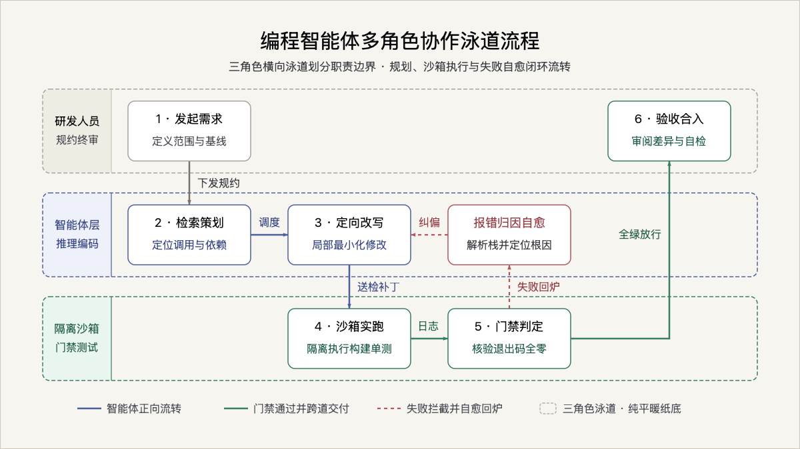

<div align="center">

# guage-svg-gen

**让 AI Agent 一次生成「零遮挡、零溢出、可源码直改」的出版级纯代码 SVG 技术配图**

[](https://github.com/guage1029/guage-svg-gen/releases)
[](#30-秒快速安装与使用)
[](#为什么选择-guage-svg-gen)
[](https://github.com/guage1029/guage-svg-gen)

**[简体中文](README.md)** · **[English](README.en.md)**

</div>

---

大多数大模型直出的 SVG 常面临「文字溢出卡片」「箭头斜穿节点」「中英混排方框乱码」「背景网格刺眼挡字」与「廉价高饱和霓虹配色」。

**guage-svg-gen** 是一套面向 **Claude Code / Codex CLI / Gemini CLI** 等编程智能体的 **确定性 SVG 工程生图 Skill**：
先生成结构化布局契约（`layout.json`），再输出 `100%` 纯代码宣言式 `<svg>`，并通过 **结构 / 语言 / 配色 / 几何包围盒** 四道严格机械门禁与真图视觉预览，确保每张技术架构图、流程图、时间线、时序图、泳道图与公众号封面开箱即用。

<p align="center">
  
</p>

> 上图使用完全同一套《编程智能体运行时与沙箱架构》语义结构，分别在 **极客暗黑（`BG-Dark` `#050506`）** 与 **暖纸极简（`BG-Light` `#F7F5F0`）** 下自动切换 **纯平（`solid`）/ 25px 点阵（`dot`）/ 40px 淡线与同底遮罩（`line`）**，全套均通过 `run_pipeline.py --strict` 四重门禁。

---

## 核心场景示例（Showcase Gallery）

下方技术图谱均围绕「**编程智能体工程体系（Coding Agent Engineering）**」同一主题创作，覆盖主流架构、流程、时间线、时序、泳道及高点击公众号封面：

### 1. 系统架构图（`BG-Dark` · `dot` 25px 微圆点阵）

适用于系统拓扑、微服务边界与智能体运行时分层解析；包含虚线权限隔离域、同源连接线着色（`Color-by-Source`）与外部语义图例。

<p align="center">
  
</p>

- SVG 源码：[docs/showcase/showcase-architecture-dark.svg](docs/showcase/showcase-architecture-dark.svg) · 浅色对照版：[showcase-architecture-light.svg](docs/showcase/showcase-architecture-light.svg)

---

### 2. 工程流程图（`BG-Light` · `dot` 25px 点阵）

适用于构建流水线、状态流转与双分支核验；三列平衡流配合正交折线（`orthogonal_edges`），清晰表达「门控通过放行」与「失败退避自愈」闭环。

<p align="center">
  
</p>

- SVG 源码：[docs/showcase/showcase-flowchart.svg](docs/showcase/showcase-flowchart.svg)

---

### 3. 演进时间线（`BG-Light` · `line` 40px 淡线 + 同底遮罩）

适用于技术演进路线、版本里程碑与阶段对比；在 `40px` 工程淡线网格上启用 **Pre-Edge Label Halos（文字同底遮罩）**，避免网格线穿透文字影响阅读。

<p align="center">
  
</p>

- SVG 源码：[docs/showcase/showcase-timeline.svg](docs/showcase/showcase-timeline.svg)

---

### 4. 交互时序图（`BG-Dark` · `solid` 纯平零纹理）

针对多角色消息与纵向生命线，默认自动路由至 **`solid` 纯平背景** 彻底消除网格对虚线生命线的视觉干扰；分段激活条（Segmented Activation Bars）精准避让交叉回传箭头。

<p align="center">
  
</p>

- SVG 源码：[docs/showcase/showcase-sequence.svg](docs/showcase/showcase-sequence.svg)

---

### 5. 多角色协作泳道流程图（`BG-Light` · `solid` 纯平暖纸底）

用于跨团队 / 跨模块 / 人机协同链路拆解；横向三泳道配合齐平左侧角色页签、`30px` 开放路由通道及「失败回炉 → 报错归因自愈」逆向重试支路，零压线、零穿框。

<p align="center">
  
</p>

- SVG 源码：[docs/showcase/showcase-swimlane.svg](docs/showcase/showcase-swimlane.svg)

---

### 6. 极客技术号文章封面（创意发光 / 渐变排版）

除工程结构图外，同样胜任高冲击力的公众号头图与技术发布封面，兼顾 `2.4:1` / `2.35:1` 视觉张力与居中构图：

<p align="center">
  
  
</p>

- SVG 源码：[gemini_cli_v0.38_cover_v2.svg](docs/showcase/gemini_cli_v0.38_cover_v2.svg) · [Wechat_Cover_Feishu_Skill_19.svg](docs/showcase/Wechat_Cover_Feishu_Skill_19.svg)

<details>
<summary><b>展开查看 2×3 风格矩阵全部 6 份 SVG 源码清单</b></summary>

| 主题 \ 纹理 | `solid` 纯平 | `dot` 25px 微圆点阵 | `line` 40px 淡线 + 同底遮罩 |
| --- | --- | --- | --- |
| **`BG-Dark` (`#050506`)** | [showcase-architecture-dark-solid.svg](docs/showcase/showcase-architecture-dark-solid.svg) | [showcase-architecture-dark.svg](docs/showcase/showcase-architecture-dark.svg) | [showcase-architecture-dark-line.svg](docs/showcase/showcase-architecture-dark-line.svg) |
| **`BG-Light` (`#F7F5F0`)** | [showcase-architecture-light-solid.svg](docs/showcase/showcase-architecture-light-solid.svg) | [showcase-architecture-light.svg](docs/showcase/showcase-architecture-light.svg) | [showcase-architecture-light-line.svg](docs/showcase/showcase-architecture-light-line.svg) |

</details>

---

## 为什么选择 `guage-svg-gen`

### 1. 智能主题 × 背景纹理自动路由矩阵

不必手动猜测背景应该配网格还是纯色，Skill 内置了覆盖全图型的确定性路由表：

| 图表类型 | 默认背景纹理 | 适用场景与设计考量 |
| --- | --- | --- |
| **Architecture / Topology / Workflow** | `dot`（25px 微圆点阵） | 轻量锚定空间坐标，同时保持模块内部留白通透 |
| **Timeline / Roadmap / Architecture Spec** | `line`（40px 工程淡线 + 同底遮罩） | 强化时间对齐与蓝图感，Label Halos 确保文字下方无穿线 |
| **Sequence / Comparison / Swimlane / WeChat Cover** | `solid`（纯平零纹理） | 消除背景纹路对生命线、泳道分割线与大字标题的视觉干扰 |

### 2. Morandi 配色契约 & `Color-by-Source`

- 废弃刺眼纯黑 `#000000` 与高饱和霓虹色，统一采用 [**Scheme 3 Morandi** 调色系统](skills/guage-svg-gen/assets/color-tokens.json)（`BG-Dark #050506` 与 `BG-Light #F7F5F0`）。
- 连接线颜色自动与**源节点**或语义分支绑定（靛蓝主链路 · 鼠尾草绿放行/异步 · 枯玫瑰红高危熔断），WCAG 对比度严格控制在 **`4.5:1` 以上**。

### 3. 四重确定性机械门禁（`run_pipeline.py --strict`）

告别凭感觉交付，任何一张成图必须依次通过 4 个自动化脚本校验，否则自动进入局部定位修复：

| 门禁脚本 | 校验维度 | 拦截典型缺陷 |
| --- | --- | --- |
| [`validate_svg.py`](skills/guage-svg-gen/scripts/validate_svg.py) | 结构、对比度、字体栈与字号 | 透明背景、外链资源、字号低于阈值（正文 `16px` / 封面 `18px`）、缺字体回退 |
| [`validate_language.py`](skills/guage-svg-gen/scripts/validate_language.py) | 中英文策略与阅读一致性 | 默认中文图表中夹杂未授权英文缩写、内部变量名直出 |
| [`validate_color.py`](skills/guage-svg-gen/scripts/validate_color.py) | Token 合规与角色映射 | 绕过调色板硬编码 Hex 色值、深浅主题色混用 |
| [`validate_geometry.py`](skills/guage-svg-gen/scripts/validate_geometry.py) | 真实像素级包围盒几何 | 节点重叠（`E_NODE_OVERLAP`）、文本溢出卡片（`E_TEXT_OVERFLOW`）、线段压字（`E_EDGE_OCCLUDED`） |

### 4. 真图渲染预览与 1:1 裁切安全区检查

[`render_preview.py`](skills/guage-svg-gen/scripts/render_preview.py) 支持 **Playwright Chromium** / **CairoSVG** 自动导出 PNG 预览，并生成公众号分享 `1:1` 中心正方形裁切图，自动校验纯白/透明角与内容占比后按 `--cleanup-dir` 清理临时目录。

---

## 30 秒快速安装与使用

### 安装 Skill

支持开放 [Agent Skills](https://agentskills.io) 标准的 **Claude Code**、**OpenAI Codex CLI**、**Antigravity** 与 **Gemini CLI**：

```bash
git clone https://github.com/guage1029/guage-svg-gen.git
cd guage-svg-gen

# 安装到指定 Agent Skills 目录（例如 Claude Code：~/.claude/skills，或 Codex / Antigravity：~/.agents/skills）
bash scripts/install.sh --dest ~/.claude/skills --yes

# 如需跳过交互并同时指定产出目录：
bash scripts/install.sh --dest ~/.agents/skills --workspace ~/Documents/svg-output --yes --skip-deps
```

如需本地启用 PNG 预览与裁剪验收：

```bash
pip install -r skills/guage-svg-gen/requirements.txt
```

### 运行环境与版本要求（开箱即用清单）

| 依赖项 | 最低版本 | 用途 | 安装说明 |
| --- | --- | --- | --- |
| **Python** | `>= 3.10` | 运行全部校验与管线脚本 | macOS: `brew install python@3.12` |
| **Pillow** | `>= 10.0.0` | 几何包围盒字体度量与裁切检查（**必需**） | `pip install -r skills/guage-svg-gen/requirements.txt` |
| **cairosvg** | `>= 2.7.1` | 渲染 PNG 预览与高清导出（**推荐必需**） | 需先装系统 Cairo：macOS `brew install cairo`；Linux `apt install libcairo2` |
| **numpy** | `>= 1.24.0` | 预览空白/透明角检测加速 | 包含在 `requirements.txt` |
| **fontconfig (`fc-match`)** | 系统自带 | CJK/Latin 字体栈真机解析（**必需**） | macOS: `brew install fontconfig`；Linux 建议装 `fonts-noto-cjk` |
| **Playwright + Chromium** | `>= 1.40.0` | 浏览器级高精度渲染后端（可选） | `pip install playwright>=1.40.0 && playwright install chromium` |
| **svgo** | `>= 3.0.0` | 可选 SVG 压缩优化 | `npm install -g svgo` |

> 导入 Skill 后若缺环境，可直接让你的 Agent 读取 `skills/guage-svg-gen/README.md` 与 `requirements.txt` 自动检测并指导安装。

Gemini CLI 扩展清单位于 [integrations/gemini/gemini-extension.json](integrations/gemini/gemini-extension.json)（已对齐 `0.17.28`）。

### 对话触发示例

安装完成后无需背诵参数，直接向你的 Agent 提出需求即可自动触发：

- **生成架构图**：`帮我画一张大模型智能体网关与沙箱运行时架构图，深色点阵风格（bg_dark · dot）`
- **生成时间线**：`用暖纸白 40px 淡线网格风格（bg_light · line）画一张 2022–2026 演进时间线，要求文字下方带遮罩`
- **生成泳道/时序图**：`按多角色泳道流程图梳理从需求输入、智能体改写到沙箱门禁自愈的闭环，先走 strict 校验再给我预览图`
- **原地修改 SVG**：`把这张现成的架构图背景切换成 solid 纯平底，并重新跑全量几何与配色门禁`

---

## 本地管线 CLI 与发布自检

面向 Skill 开发者与 CI 集成：

```bash
# 运行四重严格门禁并产出终版 SVG（成功后自动清理草稿）
python3 skills/guage-svg-gen/scripts/run_pipeline.py \
  --svg /tmp/draft.svg \
  --plan docs/architecture.layout.json \
  --output-svg docs/architecture.svg \
  --cleanup-draft \
  --strict \
  --json

# 运行 Skill 单测（14 项单元测试）
python3 skills/guage-svg-gen/scripts/test_skill_scripts.py

# 运行完整发布自检（版本一致性、JSON 合法性、零本地路径泄露及 18 项冒烟测试）
bash scripts/check_release.sh
```

<details>
<summary><b>仓库结构一览</b></summary>

```text
guage-svg-gen/
├── README.md                                  # 中文说明文档（含 Showcase 与快速上手）
├── README.en.md                               # English documentation
├── docs/showcase/                             # Showcase PNG 预览与校验通过的 SVG 源码
├── integrations/gemini/gemini-extension.json  # Gemini CLI 扩展元数据（v0.17.28）
├── scripts/
│   ├── install.sh                             # 一键安装至 Agent Skills 目录
│   ├── package_skill.sh                       # 生成纯净分发/上架包（去缓存与开发测试文件）
│   └── check_release.sh                       # 发布自检脚本（版本 / JSON / 路径 / 冒烟测试）
├── tests/                                     # 18 项端到端回归冒烟测试用例
└── skills/guage-svg-gen/                      # 核心 Skill 实现（v0.17.28 · author: donglin）
    ├── SKILL.md                               # 风格路由、契约规范与执行流定义
    ├── README.md                              # 单包开箱即用环境安装与自检文档
    ├── requirements.txt                       # 渲染与校验依赖清单
    ├── assets/                                # 调色板、字体白名单、JSON Schema 与起步模板
    ├── references/                            # BG-Dark / BG-Light 规范手册与错误码索引
    ├── evals/                                 # 基准评测集与示例工程资产（打包可精简）
    └── scripts/                               # 4 重校验器、自动修复、预览与统一编排管线
```

</details>

---

如果这个项目帮你省掉了大量调排版和修箭头的时间，欢迎点一个 **Star** 支持迭代；也欢迎在 [Issues](https://github.com/guage1029/guage-svg-gen/issues) 中提交你希望支持的图型场景或样式建议。
