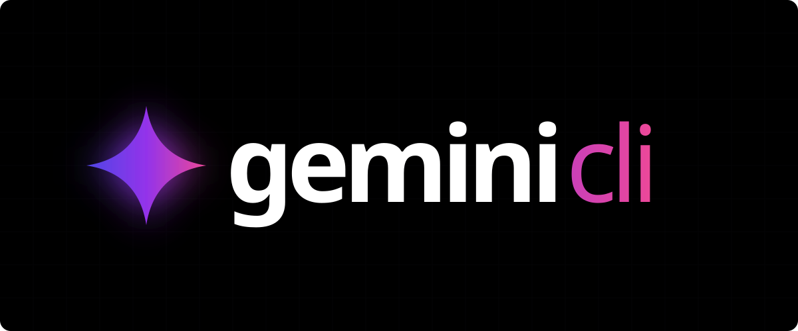

# 🎨 SVG Architect (v13.0)

**全自动工业级 SVG 设计交付引擎**

`svg-architect` 是专为 Gemini CLI 打造的专业级设计扩展。它不仅是一个绘图工具，更是一个遵循严苛美学逻辑的“设计编译器”。它能够生成达到“现代 SaaS 官网”或“Apple 商业发布会”级别的高质量、暗黑风、纯代码渲染的 SVG 技术图表。

---

## 🌟 项目亮点与优势

1. **💰 不在图片上额外花钱**：纯代码生成，无需订阅昂贵的设计软件。
2. **🤖 用 Agent 生成代码绘制图片**：完美适配 AI Agent，通过指令驱动，一键出图。
3. **🎭 多场景覆盖**：非常适合文章封面、文章插图、PPT 配图等多种应用。
4. **🧱 复杂概念解释专家**：特别擅长技术类原理解释、技术架构等高度复杂概念的视觉化呈现。
5. **🕊️ 实现真正的图片创作自由**：摆脱素材库束缚，随心所欲定制您的视觉语言。
6. **🔌 极速迁移适配**：即使不使用 Gemini CLI，下载后在您的 Agent 中稍作转换（格式转换）即可直接使用。
7. **⭐ 留下个小星星，不过分吧**：如果您觉得好用，请点击右上角的 Star 给予支持！

---

## 🖼️ 设计成品展示 (Showcase)

以下是通过 `svg-architect` 引擎直接生成的工业级设计稿：

### 1. 架构全景图 (System Architecture)


### 2. 自动化流程图 (Workflow Automation)


### 3. 公众号封面与运营配图
<p align="center">
  
  
</p>

### 4. 逻辑模型与思维导图
<p align="center">
  
  
</p>

---

## 🚀 核心特性

- **工业级交付标准**：生成的 SVG 采用绝对路径（Absolute Paths），无冗余内联样式，确保跨平台渲染一致性。
- **暗黑美学驱动**：默认采用 `Tech Dark` 模式（纯黑背景 `#000000` + 霓虹发光 `Glow` 滤镜）。
- **智能场景对齐**：内置公众号封面、文章配图、极简图卡三种标准尺寸规范。
- **逻辑自愈系统**：内置 Python 脚本（`svg_fixer.py` / `svg_validator.py`）自动修正对比度、视图框（ViewBox）及非法 ID。
- **指纹对比生成**：支持记录设计变更，确保重生成（Regenerate）时的差异化清晰可见。

---

## 📦 安装指南

在您的终端中执行以下命令，直接从 GitHub 仓库安装：

```bash
gemini extension install https://github.com/zhaodl1983/-svg-architect.git
```

安装完成后，可以通过以下命令验证：

```bash
gemini extension list
```

---

## ⚙️ 配置要求

### 环境依赖
本 Skill 使用 Python 脚本进行 SVG 的后处理优化。请确保您的系统已安装：
- **Python 3.8+**
- **依赖库**：在 `skills/svg-architect/` 目录下运行 `pip install -r requirements.txt`。

### 目录结构
```text
.
├── gemini-extension.json     # 扩展定义文件
├── docs/                     # 文档与静态资源
│   └── showcase/             # 设计作品展示
└── skills/
    └── svg-architect/        # 核心 Skill 逻辑
        ├── SKILL.md          # 指令集与设计规范
        ├── resources/        # 字体白名单、布局 Schema
        └── scripts/          # SVG 优化与校验脚本
```

---

## 🎨 使用方法

### 1. 触发任务
在 Gemini CLI 交互界面中，直接输入您的设计需求。例如：
- *“帮我设计一个关于‘分布式系统架构’的公众号封面，要深蓝色调。”*
- *“生成一个展示‘AI 模型推理流程’的 16:9 配图，使用霓虹绿发光效果。”*

### 2. 工作流阶段
Skill 会引导您经历以下三个阶段：
- **[Phase 0] 场景对齐**：确认画布尺寸（封面、配图或图卡）。
- **[Phase 1] 方案发现**：确定配色方案（Palette）与视觉重心。
- **[Phase 2] 交付输出**：直接输出高保真 SVG 代码，并自动调用校验脚本。

---

## 🛠️ 脚本工具说明

如果您需要手动优化现有的 SVG 文件，可以利用扩展内置的脚本：

- **验证 SVG 合规性**：
  ```bash
  python skills/svg-architect/scripts/svg_validator.py input.svg
  ```
- **自动修复对比度与格式**：
  ```bash
  python skills/svg-architect/scripts/svg_fixer.py input.svg output.svg
  ```

---

## 🤝 贡献与反馈

如果您在使用过程中发现 Bug 或有新的美学建议，欢迎提交 Issue 或 Pull Request。

**作者**：zhaodl1983  
**许可证**：MIT
